# Cheese CI — квадратный сейф

Репозиторий содержит инструкцию, связанные Markdown-памятки и иллюстрации. Модели STL/STEP, архивы и скрипты не входят в Git: указанные ниже пути относятся к локальному комплекту файлов, который распространяется отдельно.

Инструкция по печати, примерке и сборке текущего варианта: **12 одноцветных светодиодов, два MG996R, OLED и ESP32**. Шесть красных индикаторов находятся сверху, шесть зелёных — снизу. Предполагаемое условие открытия: все шесть проверок пройдены, горят только зелёные. Эта инструкция описывает механическую сборку; электрическая схема, назначение GPIO и прошивка требуют отдельной разработки.

## 1. Какие файлы использовать

**Усиление остальных узлов:** обновлены **01, 02, 13, 14, 16, 17, 18, 20, 21, 22**. [Что добавлено и как печатать](Усиление-конструкции.md). **Настил 17 теперь печатается верхней стороной на столе, рёбрами вверх** — используйте ориентацию нового STL. У крепежа крышки и петель может потребоваться увеличение длины винтов на 0,8–1,2 мм. Проверенные удачные старые детали можно сохранять.

**Усиление стенок 09 после физической примерки:** добавлены четыре треугольных ребра толщиной 2,4 мм на внутренней стороне каждой стенки (всего восемь), от основания до высоты 51,2 мм в сборочных координатах. Верх рёбер ниже ползунка и качалки. Снаружи верхняя зона стенок дополнительно утолщена: одна на 2 мм, другая на 1,2 мм, в пределах прежнего габарита основания. Рабочая ширина направляющих, высота столбиков 25 мм и крепёж сохранены. Рёбра опираются на основание и сужаются вверх, поэтому не требуют съёмных поддержек. В этой правке изменена только 09; прежние 10 и 11 подходят. Предыдущий комплект — `before-wall-ribs/`.

Это усиление уменьшает гибкость стенок, но не является подтверждением стойкости к стопорному моменту MG996R. Если палец качалки доходит до края паза 11, привод продолжает нагружать детали; рабочие пределы сервы нужно выставить до такого положения. Полный тестовый диапазон 500–2500 мкс предназначен только для отсоединённой от ползунка качалки. Не разжимать рельсы, чтобы установить ползунок: вставлять его с торца. Перед снятием со стола дать PLA остыть; горячая деталь может получить остаточную деформацию даже с рёбрами.

**Обновление по ролику AlexGyver:** [изменения и разбор всех деталей](video-review/Изменения-по-ролику.md). Добавлены усиления у оснований стоек, нижние фаски 0,2 мм, скругления углов ползунка и крыша горизонтального отверстия петли 21. Все STL экспортированы с отклонением 0,025 мм. Столбики 09 остаются 25 мм над основанием. Уже напечатанные удачные детали совместимы с обновлёнными.

**Текущая высота столбиков 09: 25 мм над верхней поверхностью основания**, или 28 мм от низа печатной детали. В сборочных координатах верх столбиков и низ рамки 10 находятся на Z=31,2 мм. Это заменяет прежний вариант с удлинением на 7,5 мм; проставки 7,5 и 7,75 мм для этой версии не нужны. Поднятые на 11 мм рельсы и скосы 45° сохранены. Печатная рамка 10 остаётся прежней; меняется только её положение на столбиках. Изменён только STL 09. Предыдущий комплект сохранён в `before-posts-25mm/`.

**Исправление по реальной серве:** рельсы 09, положение ползунка 11, мыши 12 и выхода в корпусе подняты на **11 мм**. Изменены STL **01, 09 и 17**. Прежние **08 и 10–12** подходят: рамка 08 крепится выше, ползунок и мышь устанавливаются на поднятые рельсы. Высота стоек крепления сервы уточнена отдельно выше; печатная рамка 10 не меняется. Предыдущий комплект сохранён в `before-mouse-lift/`.

В настиле 17 добавлены две краевые выемки под поднятые крепления рамки 08: до координаты X=7,2 мм, ширина каждой 8,8 мм, центры Y=−90 и −29 мм в сборочных координатах. Если старый настил уже напечатан, достаточно аккуратно вырезать/выпилить эти выемки по новой модели, вместо полной перепечатки.

Полный актуальный набор находится в папке STL-current (`STL-current`): в нём уже собраны все 22 STL с нужными вариантами и скосами под нависающими выступами. [Список изменений и особенностей поддержек](Изменения-45-градусов.md). Полный архив (`Cheese-CI-current.zip`).

В текущем наборе выбраны следующие варианты:

| № | Файл текущей версии | Количество |
|---|---|---:|
| 01 | Корпус под 12 LED (`STL-current/01-square-shell-12led.stl`) | 1 |
| 05 | Панель под 12 LED (`STL-current/05-control-panel-12led.stl`) | 1 |
| 10 | Рамка MG996R без пазов под саморезы (`STL-current/10-mg996r-saddle-no-servo-holes.stl`) | 2 |

Все остальные детали также берите из `STL-current/`. Не печатайте одновременно старую и новую версии одного номера. Прежние `STL/` и архив `Cheese-CI-Square-models.zip` не являются полным актуальным комплектом.

STL заданы в миллиметрах. Каждую крупную деталь размещайте на отдельной пластине Bambu Studio. Если несколько импортированных файлов объединились в один объект, перед раскладкой разделите их на объекты; печатать сборку целиком не нужно.

Уже напечатанные удачные детали сохраняйте, если они соответствуют текущим посадкам. Из версии клином можно использовать 06–08, 11–12 и 14–16 после примерки. Для текущего варианта нужны актуальные 01, 05 и 09: старая низкая 09 не совпадает с поднятым выходом мыши. Для 10 используйте выбранный вариант с вырезами под провод.

## 2. Как устроен сейф

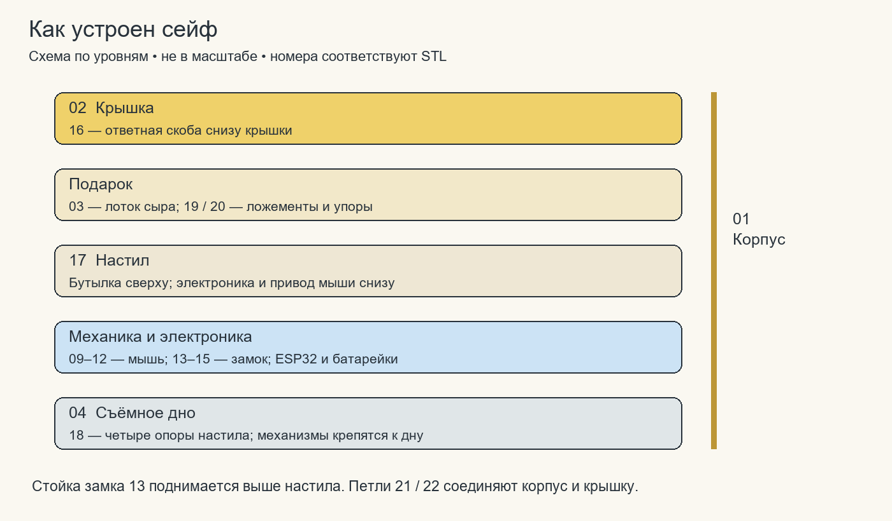

На съёмном дне **04** стоят электроника, батарейный отсек и механизмы. Четыре опоры **18** держат настил **17**. Над ним находятся бутылка на ложементах **19**, упоры **20** и лоток сыра **03**. Стойка замка **13** поднимается к крышке; засов **15** удерживает ответную скобу **16**. Выдвижная мышь использует основание **09**, ползунок **11** и фигурку **12**.

Корпус без наружных креплений — **246 × 246 мм**. В CAD проверена бутылка как цилиндр **длиной 270 мм и диаметром 66 мм**, вместе с упаковкой сыра **100 × 70 × 50 мм**. Объём 0,33 или 0,5 л сам по себе не гарантирует посадку: измерьте настоящую бутылку вместе с пробкой. Ложементы и упоры можно переставлять по отверстиям настила.

### Как определить перед, зад и верх

- **Перед 01** — стенка с прямоугольными проёмами экрана/кнопки и фигурным выходом мыши. **Зад** — противоположная стенка с двумя местами крепления петель.
- **Верх дна 04** — поверхность, на которой стоят механизмы. Потайные входы большинства крепёжных отверстий и неглубокие выемки для стяжек обращены **вниз**, к столу. Винты дна вставляются с этой нижней стороны.
- **Внутренняя сторона крышки 02** — сторона крепления скобы 16; на наружной стороне видны сырные углубления и две усиленные площадки потайного крепежа скобы.
- Ориентация импортированного STL относится к **печати**, а не обязательно к сборке. Это особенно важно для настила 17.

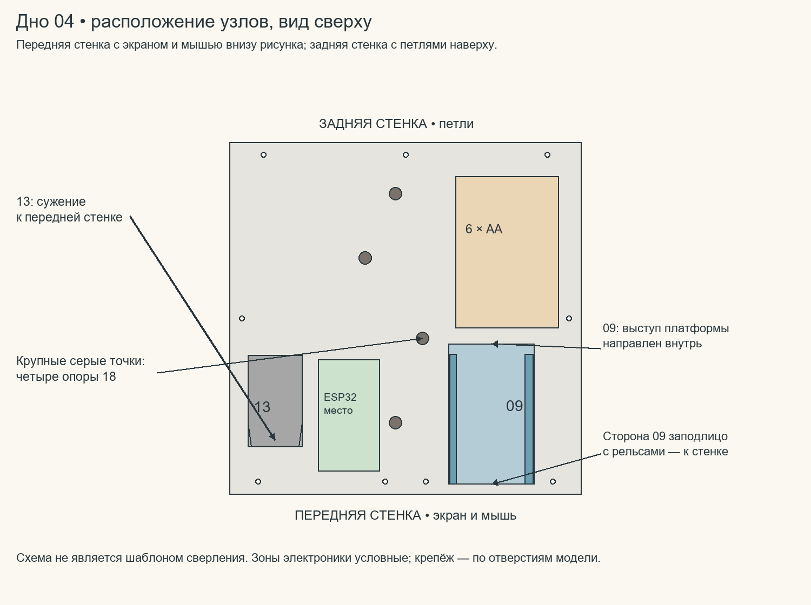

На схеме передняя стенка внизу: 13 — слева, 09 — справа. Это схема расположения, не шаблон сверления. Поворачивайте 04 до совпадения всех отверстий с деталями и задней стороной корпуса; не сверлите новые отверстия по картинке.

## 3. Все детали: количество и цвет

Жёлтый пластик в первую очередь оставьте на **01 и 02**. Для скрытой механики можно использовать другой PLA+. Цвет не влияет на совместимость. Для нагруженных креплений и подвижных деталей предпочтителен обычный PLA+, а декоративный Silk лучше оставить для внешних элементов.

| № | Деталь | Штук | Где видна | Цвет |
|---|---|---:|---|---|
| 01 | Корпус, текущий вариант 12 LED | 1 | Снаружи | Жёлтый для сырного оформления |
| 02 | Крышка | 1 | Снаружи | Жёлтый для сырного оформления |
| 03 | Лоток сыра | 1 | При открытии | Любой по оформлению |
| 04 | Съёмное дно | 1 | Снизу | Любой |
| 05 | Панель, текущий вариант 12 LED | 1 | Снаружи | Жёлтый или контрастный |
| 06 | Колпачок кнопки DEPLOY | 1 | Снаружи | Контрастный или жёлтый |
| 07 | Скоба обычной кнопки | 1 | Скрыта за панелью | Любой |
| 08 | Рамка проёма мыши | 1 | Снаружи | По оформлению |
| 09 | Основание механизма мыши | 1 | В основном скрыто под настилом | Любой |
| 10 | Крепление MG996R | 2 | Внутри; верхнее видно при открытии | Любой |
| 11 | Ползунок мыши | 1 | При выдвижении | По оформлению |
| 12 | Фигурка мыши | 1 | При выдвижении | По оформлению |
| 13 | Стойка замка | 1 | Верхняя часть при открытии | Любой |
| 14 | Направляющая замка | 1 | При открытии | Любой |
| 15 | Засов | 1 | При открытии | Любой |
| 16 | Ответная скоба замка | 1 | Снизу открытой крышки | Любой |
| 17 | Настил отсека подарка | 1 | При открытии | Любой по оформлению |
| 18 | Опора настила | 4 | Скрыта под настилом | Любой |
| 19 | Ложемент бутылки | 2 | При открытии | Любой по оформлению |
| 20 | Упор бутылки | 2 | При открытии | Любой по оформлению |
| 21 | Половинка петли на корпусе | 2 | Сзади | Жёлтый или контрастный |
| 22 | Половинка петли на крышке | 2 | Сзади | Жёлтый или контрастный |

Всего **22 типа, 30 печатных деталей**. Детали 09 и 10 могут частично просматриваться через проём мыши: полной невидимости со всех ракурсов нет.

## 4. Что подготовить для сборки

- Два имеющихся MG996R, их качалки и подходящий к ним крепёж.
- ESP32 с платой расширения, OLED SSD1306 I²C 0,96″ и обычную кнопку без фиксации.
- Шесть красных и шесть зелёных светодиодов с телом Ø5 мм и ободком не более Ø5,8 мм; отдельный токоограничивающий резистор для каждого.
- Держатель на шесть AA, батарейки, понижающий модуль и провода. Работу двух MG996R от этого питания сначала проверить на столе: геометрическая посадка не подтверждает достаточность питания.
- Винты М3 подходящих длин, гайки и шайбы. Для осей петель — два М3×25 с гайками либо гладкие штифты Ø3 мм. Полная ведомость длин крепежа пока не составлена.
- Стяжки для электроники и батарейного отсека, две мягкие ленты для бутылки и мягкие прокладки в ложементы.
- Дрель с тонкими свёрлами, отвёртки, паяльник и изоляцию выводов.

Для пружинки, слегка приподнимающей крышку, есть гнездо Ø4,9 мм. Пружинка необязательна; подбирайте её после проверки свободного открывания.

## 5. В каком порядке печатать

После каждой примерки устраните проблему в соответствующем узле и только затем переходите дальше. Успешные детали идут в итоговую сборку — отдельных одноразовых тестовых образцов не требуется.

| Этап | Напечатать | Проверить перед продолжением |
|---|---|---|
| 1. Серва | Одну **10**, без пазов | Корпус MG996R входит в проём, ушки опираются на рамку, провод выходит через боковой вырез. Разметить и проверить крепление саморезами |
| 2. Привод мыши | **09 и 11** | Свободный ход ползунка, установка сервы с рамкой 10, движение от качалки без закусывания |
| 3. Замок | **13–16** и вторую **10**, после успеха первой | Засов движется свободно, входит в ответную скобу и полностью выходит из неё; привод работает на столе |
| 4. Мелкие посадки | Новую **05**, **06–07**, по одной **21 и 22**, один **19** | Подходят реальные экран, LED и кнопка; петля вращается на выбранной оси; бутылка с прокладкой ложится в ложемент |
| 5. Компоновка | **04** | Прикрутить механизмы, разложить батарейный отсек, ESP32, преобразователь и провода. Проверить крепёж и доступ к нему |
| 6. Отсек подарка | Сначала одну **18**, после проверки ещё три; затем **17**, второй **19** и два **20** | Собрать на дне, положить настоящую бутылку и упаковку сыра. Настил и проводка не мешают механизмам |
| 7. Корпус | Новую **01**, затем **08** | Установить дно и панель, проверить выход ползунка через проём и положение замка |
| 8. Завершение | **02**, вторую пару **21/22**, **03** и **12** | Совпадение замка, закрывание крышки и её открывание с бутылкой внутри |

Корпус **01** и крышка **02** печатаются ближе к концу: их дороже переделывать. Дно **04** нужно раньше как основание для проверки компоновки. До корпуса можно разложить сборку по бумажному контуру 246 × 246 мм с учётом толщины стенок 2,8 мм и скруглений; это приблизительная проверка, а не замена примерке корпуса.

## 6. Печать на Bambu Lab A1

Принтер: **A1, сопло 0,4 мм**, слайсер Bambu Studio. Как отправную точку используйте слой 0,2 мм и профиль своего PLA. Прочность креплений, посадки и качество первого слоя проверяйте по первым небольшим деталям.

- STL экспортированы в положении для печати. После импорта убедитесь, что деталь действительно лежит на столе плоской стороной.
- Крупные детали печатайте по одной на пластине; проверьте размещение, включая кайму и служебные области. Номинальный корпус 246 мм близок к ширине стола 256 мм.
- В предпросмотре слоёв проверьте мосты над проёмами корпуса, выступы под настил и отверстия петель. Поддержки добавляйте только там, где они нужны и доступны для удаления.
- У обновлённых **01, 09, 13, 14, 19 и 21** нависающие выступы поддержаны скосами или изменением формы и ориентации. **14 и 21 печатайте в новой ориентации STL**, основанием/нижним торцом вниз. Для **22** используйте локальные съёмные поддержки под нависающей частью петли. Короткие закрытые каналы 14 и 16 остаются мостами: подробнее в [памятке изменений](Изменения-45-градусов.md).
- Перед примеркой удалите поддержки, наплывы первого слоя и заусенцы. Ползунки должны двигаться без усилия ещё до подключения сервоприводов.
- Не увеличивайте масштаб всей детали ради одной тугой посадки: так сместятся остальные соединения. Сначала найдите конкретное место, которое мешает.

## 7. Рамки сервоприводов и механизмы

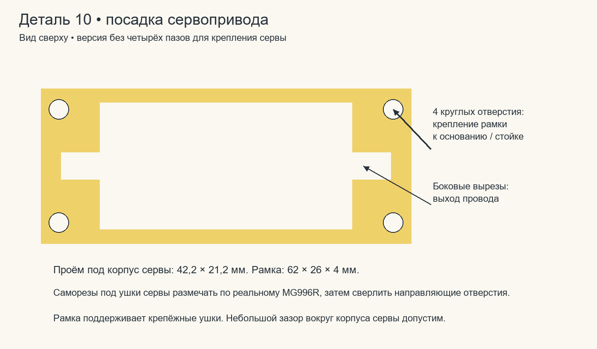

### Рамка 10

Габарит рамки — **62 × 26 × 4 мм**, основной проём — **42,2 × 21,2 мм**. Два боковых выреза служат для выхода провода. Четыре круглых отверстия нужны для крепления самой рамки к основанию или стойке и сохраняются в версии без пазов.

1. Вставьте MG996R и выведите провод без пережатия.
2. Ушки сервы должны опираться на рамку; небольшой зазор между её корпусом и стенками проёма допустим.
3. Через ушки отметьте места крепления. Проверьте, что выбранные саморезы не попадают в боковые вырезы и не выходят в пустоту.
4. Просверлите направляющие отверстия под фактические саморезы и закрепите серву без перетяжки. Не рассчитывайте, что любая длина комплектного самореза подходит к рамке толщиной 4 мм.

### Выдвижная мышь: 08–12

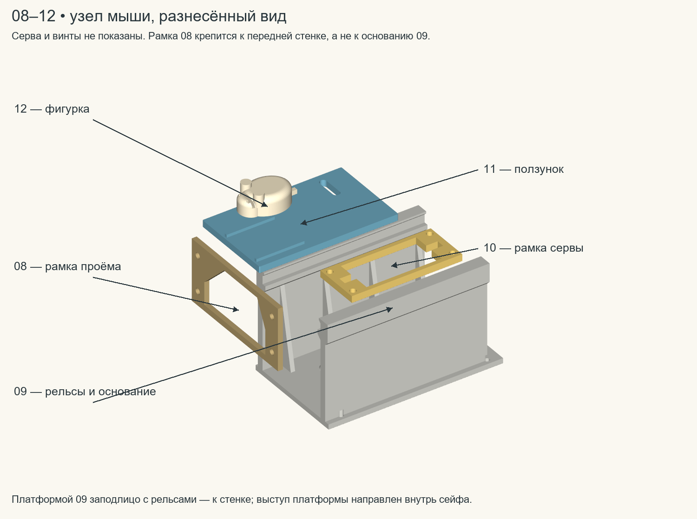

**Положение 09 и крепление к дну:**

1. Поставьте **09** плоской горизонтальной площадкой на верх 04, рельсами вверх. **Сторона, где рельсы доходят до края площадки, направлена к передней стенке и выходу мыши. Выступ площадки за рельсами направлен внутрь сейфа.**
2. Совместите четыре отверстия основания 09 с отверстиями 04. Вставьте винты М3 снизу 04 и вкрутите в 09, равномерно притягивая основание без изгиба.
3. Рамку **10** положите на четыре столбика 09 и закрепите четырьмя круглыми отверстиями. В последней версии столбики **25 мм над основанием**, дополнительных проставок нет. Серва стоит валом вверх, корпусом вниз; её ушки опираются на рамку 10. Крепёж ушек отдельный от четырёх винтов рамки.

**Ползунок и фигурка:**

1. У **11** широкая площадка лежит горизонтально. Две невысокие полоски-ограничителя под мышь направлены **вверх**. Конец с фигуркой мыши направлен наружу, конец с продолговатым приводным пазом — внутрь сейфа, к серве.
2. Вставьте 11 **с торца рельсов**, между нижними опорными полками и верхними удерживающими бортиками. Не вставляйте сверху разжиманием стенок. Сначала проверьте свободный ход без качалки.
3. Поставьте **12** плоским низом на переднюю часть 11, между ограничителями. Мордочка и паз карточки обращены к выходу, хвост — внутрь. В модели нет отдельного винта крепления мыши: при необходимости закрепите её маленьким участком липучки/двустороннего скотча, не выступающим за низ ползунка.

**Качалка и рамка выхода:**

1. Перед соединением задайте серве известное среднее положение. Качалка располагается **под 11**, винт-палец М3 на одном её плече направлен вверх и входит снизу в поперечный паз 11. Номинальный радиус от оси вала до пальца — **18 мм**, полный ход ползунка — **30 мм**.
2. Палец закрепляется на качалке, но **не стягивает 11 гайкой**. Он должен скользить вдоль паза, пока площадка перемещается вдоль рельсов. Свободный конец качалки и центральный винт не должны задевать корпус 09 и низ ползунка.
3. Рамка **08** устанавливается **снаружи передней стенки 01**, плоской стороной к стенке, по четырём отверстиям вокруг проёма. Она не крепится к основанию 09. Высокая часть фигурного проёма — сверху, прямая нижняя кромка — под ползунком.
4. После установки корпуса проверьте ручной ход 11 с мышью через 08: ни площадка, ни уши, ни карточка не должны цепляться за рамку. Только после этого подбирайте конечные положения сервы, не доводя палец до концов паза. Полный тестовый диапазон 500–2500 мкс применять только с отсоединённым механизмом.

Сначала проверьте ползунок вручную, затем привод на столе. Перед закреплением качалки задайте серве известное положение. Не заставляйте её давить на механический упор.

Текущая высота низа ползунка — **55 мм** от низа съёмного дна. В проверке CAD использован предварительный контур по ранним замерам: верх корпуса сервы 52,6 мм, верх качалки/центрального винта 54,1 мм, то есть расчётные зазоры 2,4 и 0,9 мм. Эти измерения получены до уточнения способа установки рамки; после правильного закрепления ушек на 10 **повторно проверьте фактические зазоры**, не считайте указанные значения гарантированной посадкой реальной сервы.

Винт-палец должен доставать от качалки в паз поднятого ползунка. В проверочной модели использован палец Ø3 мм с верхушкой на высоте 58,4 мм (примерно 4,3 мм над измеренным верхом качалки). Подбирайте длину по реальной толщине качалки, шайбам и гайкам; палец не должен тереться о край паза. В CAD проверена номинальная ось качалки X=52, Y=4 мм и радиус 18 мм; фактическое положение оси и отверстия своей качалки необходимо сверить при примерке.

Для карточки в мыши после подъёма остаётся высота **до 72,5 мм от низа дна**: примерно 8,3 мм над низом паза держателя. Прежняя высокая карточка при уборке может задевать настил; используйте короткую вставку. Фигурка без карточки проходит под настилом.

### Замок: 13–16 и второе крепление 10

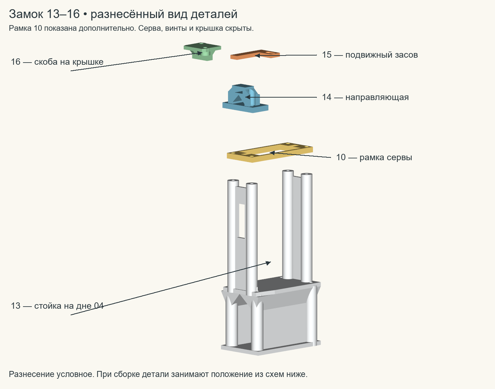

На схеме показаны актуальные усиленные детали. Они специально разнесены для наглядности; при сборке зазоров между стойками и рамкой 10, а также рамкой 10 и основанием направляющей 14 быть не должно. Скоба 16 устанавливается отдельно на крышке и не прикручивается к стойке 13.

**Последовательность сборки неподвижной части:**

1. Закрепите основание **13** плоской нижней площадкой на верхней стороне **04**, четырьмя винтами М3 снизу дна. **Сужение приподнятой платформы 13 направлено к передней стенке, где экран и мышь; широкая сторона — внутрь сейфа.** На стороне сужения ставится направляющая 14 и выходит засов. Контроль по отверстиям основания: пара с межцентровым расстоянием 26 мм ближе к передней стенке, пара 30 мм — внутрь. Проверьте, что стойка не качается.
2. Поставьте второе крепление **10** на четыре верхних столбика. Серва устанавливается корпусом вниз в проём рамки, её крепёжные ушки опираются на рамку. Провод выведите через предусмотренные вырезы, не зажимая его между деталями.
3. Установите **14** основанием вниз на стороне выхода засова, совместив два отверстия её основания с двумя отверстиями рамки 10 и соответствующими столбиками 13. Эти два винта проходят через **14 и 10 в столбики 13**; на другой стороне рамка 10 крепится непосредственно к оставшейся паре столбиков. Через проходы сверху направляющей должен оставаться доступ отвёрткой.
4. Длину общих винтов выбирайте с учётом суммарных 8 мм пластика (4 мм рамка + 4 мм основание направляющей) и требуемого захода в столбик. Винт не должен упираться в дно отверстия. Крепёж ушек самой сервы — отдельный, через рамку 10.

**Установка подвижной части и качалки:**

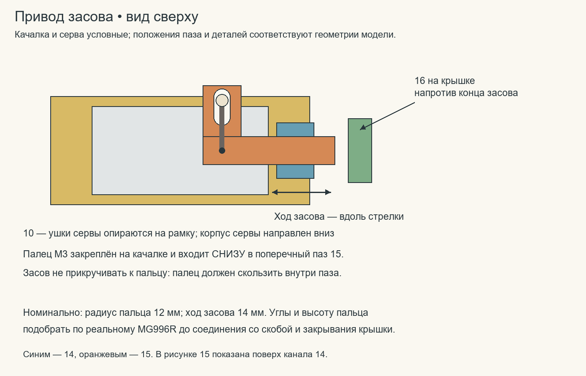

1. Вставьте узкий длинный язычок **15** в горизонтальный канал **14**. Широкая часть с продолговатым пазом остаётся снаружи канала, над сервой. Не пытайтесь протолкнуть широкую часть через направляющую.
2. До соединения с сервой проверьте перемещение засова вручную: он должен проходить без разжима стенок, сильного трения и закусывания.
3. Задайте серве известное среднее положение, пока качалка отсоединена от засова. Затем установите качалку примерно поперёк направления хода засова, свободным плечом в сторону продолговатого паза.
4. Закрепите на качалке винт-палец М3, направленный вверх. Номинальное расстояние от оси вала до центра пальца — **12 мм**. Палец входит **снизу в паз 15**, но не стягивает засов гайкой: он должен скользить вдоль паза.
5. Высоту пальца подберите по реальной серве, качалке, гайке и шайбам. Качалка и центральный крепёжный винт должны проходить под засовом с зазором, а палец — заходить в паз. Высотная посадка этого второго привода ещё требует физической примерки с вашим MG996R; на картинке серва условная.

**Крышка и ответная скоба:**

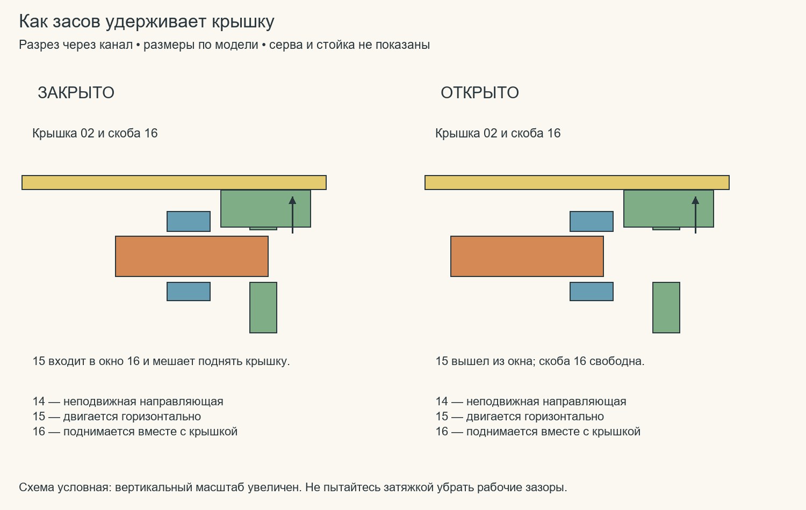

1. Вставьте гайки в предусмотренные карманы **16** и закрепите скобу с внутренней стороны крышки **02**, крепёжными винтами сверху крышки. Плоская монтажная площадка скобы обращена к крышке, её окно находится ниже площадки и смотрит на конец засова.
2. Сначала примеряйте зацепление вручную, с доступным снизу механизмом. В закрытом положении конец **15** входит в окно **16**. При отводе назад он полностью выходит из окна, и скоба может подняться вместе с крышкой.
3. Номинальный полный ход засова — **14 мм**. Рабочие углы сервы настройте по фактическому освобождению скобы, не доводя палец до концов паза и не заставляя серву давить в упор.
4. Полный тестовый диапазон **500–2500 мкс** предназначен для сервы, отсоединённой от механизма. Не проверяйте весь этот диапазон с установленным засовом.

Цвета на схемах: **13** — серый, **10** — жёлтый, **14** — синий, **15** — оранжевый, **16** — зелёный. Они обозначают детали, а не обязательные цвета пластика. Картинки не являются размерными чертежами.

## 8. Дно, настил и подарок

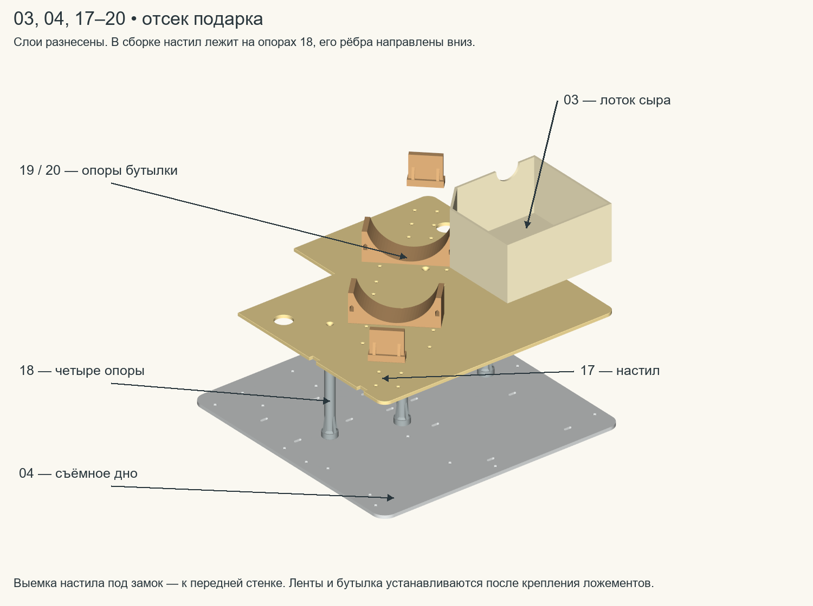

### 04 и 18: опоры и размещение электроники

1. Разверните 04 по плану дна выше. Четыре **18** ставятся **широкими фланцами с косынками вниз**, на 04; узкие торцы — вверх, к настилу 17.
2. Винты нижнего крепления опор вводятся **снизу 04** в центральные отверстия 18. Верхние отверстия опор остаются свободны для отдельного крепления настила. У всех четырёх опор одинаковая высота; не делайте набор разной высоты из старых и произвольных проставок.
3. Механизмы 09 и 13 закрепите по своим разделам. Электроника и батарейный отсек притягиваются стяжками через пазы 04; выемки снизу позволяют утопить часть стяжек. Не используйте крепёжные отверстия механизмов как произвольные отверстия под провода.
4. До настила проверьте доступ к батарейкам, разъёмам и винтам, а также запас длины проводов для снятия дна. Размещайте провода вне качалок и ползунков. Установочные зоны — 106 × 72 × 52 мм для AA-отсека и 78 × 43 × 38 мм для платы с расширителем; фактические разъёмы в них нужно примерить.

### 17: какой стороной и как закрепить

1. **В сборке рёбра 17 смотрят вниз, к электронике, а ровная сторона вверх, к бутылке.** Это противоположно положению печати актуального STL.
2. Большую прямоугольную выемку настила расположите **над стойкой замка 13**, к переднему углу сейфа со стороны панели. Две маленькие краевые выемки должны совпасть с верхними креплениями рамки мыши 08. Если не совпадают — не изгибайте настил, проверьте разворот.
3. Сначала примеряйте настил на опоры без затяжки. Рёбра не должны опираться на проводку и качалки; настил должен лежать на предусмотренных опорах/полках без качания.
4. Четыре винта крепления настила вводятся **сверху 17** в верхние отверстия 18. Потайные головки должны оставаться заподлицо. Отдельные винты ложементов и упоров ставятся **снизу**, поэтому сначала выполните следующий пункт.

### 19 и 20: держатели бутылки

1. Два **19** стоят **плоскими основаниями на верхней стороне 17**, вогнутыми седлами вверх. Расположите их вдоль диагонали настила: бутылка проходит через оба седла. Прорези для мягких лент остаются доступны с боков.
2. Два **20** стоят плоскими основаниями на 17, по концам бутылки. Вертикальные стенки находятся поперёк её продольной оси и ограничивают перемещение дна и горлышка/пробки. У этой формы нет отдельной обязательной стороны «к пробке»: подберите доступные пары отверстий по реальной бутылке.
3. Подберите положение 19 и 20 на **ещё снятом настиле**, используя настоящую бутылку с прокладками. Крепление каждого 19 — двумя винтами через 17 снизу, каждого 20 — также двумя винтами снизу. Головки должны утопиться в предусмотренные потаи, а концы — не выйти в седло или к стеклу.
4. Проденьте две мягкие ленты через прорези 19 до окончательной установки бутылки. Добавьте прокладки; подтягивайте ленты без сильного давления на стекло.
5. После установки крепежа снизу закрепите настил на 18 сверху. Проверьте, что держатели не закрыли доступ к четырём винтам настила.

### 03: съёмный лоток сыра

1. **03** устанавливается открытой частью вверх, плоским дном на 17, в оставшемся боковом участке рядом с бутылкой. Две длинные наружные стенки следуют боковой и задней стенкам корпуса, срезанный угол обращён к внутренней части отсека. Выемка для пальца находится на стенке, обращённой к бутылке; сверяйтесь со схемой отсека подарка.
2. Выемка для пальца находится на верхней кромке лотка. В модели нет винтового крепления 03: лоток должен свободно выниматься вверх, без демонтажа бутылочных опор.
3. Примерьте сыр в упаковке и доступ к лотку с установленной бутылкой. Крышка должна закрываться без давления на упаковку или пробку.

### Общая контрольная сборка

1. Закрепите механизмы и четыре опоры **18** на дне **04** винтами М3.
2. Батарейный отсек и электронику притяните стяжками через предусмотренные пазы. В CAD проверялись зоны **106 × 72 × 52 мм** под AA-отсек и **78 × 43 × 38 мм** под ESP32 с расширителем. Сравните их с реальными деталями, включая разъёмы и выход проводов.
3. Уложите проводку вне хода качалок, ползунка и засова. Оставьте возможность снять дно и заменить батарейки.
4. Поставьте настил **17** на опоры. Подберите отверстия для ложементов **19** и упоров **20** по настоящей бутылке. Потайные винты для них ставятся **снизу настила** — установите их до окончательного монтажа настила.
5. Добавьте мягкие прокладки в ложементы и две ленты через их прорези. Лоток **03** устанавливается сверху и вынимается за выемку.
6. Примерьте бутылку, сыр в упаковке и крышку. Для вертикального извлечения бутылки крышку нужно открывать немного дальше прямого угла.

## 9. Панель, кнопка и 12 светодиодов

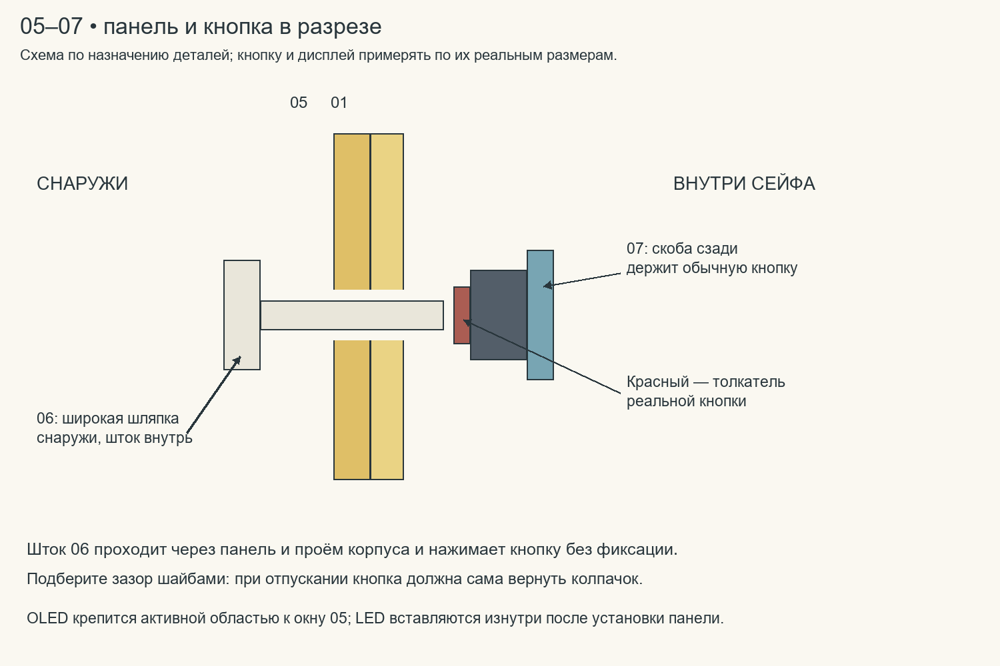

### 05–07: ориентация и крепление

1. Поставьте **05 снаружи передней стенки 01**, плоской лицевой стороной наружу. Направляющая дисплея и две бобышки под скобу 07 обращены внутрь корпуса. При взгляде на сейф спереди окно экрана находится слева, кнопка посередине, два ряда LED справа.
2. Закрепите 05 четырьмя угловыми отверстиями, винтами снаружи в крепления корпуса. Убедитесь, что панель прилегает без изгиба, а крепёж не выступает к плате дисплея и проводам.
3. Вставьте **06 снаружи**: широкая шляпка с надписью DEPLOY остаётся перед панелью, узкий шток проходит внутрь. Не переворачивайте колпачок и не зажимайте его крепежом — он должен свободно перемещаться вдоль штока.
4. **07 устанавливается изнутри**, позади двух бобышек панели и напротив штока 06. Совместите её два отверстия с отверстиями бобышек 05 и закрепите подходящими винтами. Шайбами регулируется расстояние от панели до скобы.
5. Закрепите реальную кнопку без фиксации на скобе так, чтобы её толкатель смотрел **в сторону штока 06**, а контакты не касались друг друга и платы. Способ фиксации зависит от вашей кнопки: скоба не является универсальным резьбовым посадочным местом для любого типоразмера.
6. До пайки и окончательной затяжки нажмите и отпустите колпачок несколько раз. Шток должен нажимать толкатель, не давить в корпус кнопки, а пружина реальной кнопки — возвращать 06. При заедании проверяйте соосность и зазор, не пытайтесь компенсировать это перетяжкой винтов.

### Дисплей и светодиоды

Плату OLED ставьте с внутренней стороны 05, активной областью к прямоугольному окну. Ориентация разъёма определяется реальной платой и направлением изображения; сверяйте видимую область до крепления. В модели предусмотрены опорные элементы, но не универсальная сетка отверстий для всех OLED-модулей. Дополнительную фиксацию выбирайте по вашему модулю; непроводящие прокладки и крепёж не должны давить на стекло и компоненты.

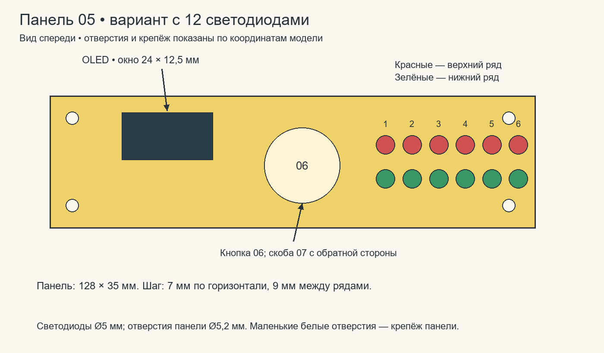

Новая панель **05** имеет размер **128 × 35 мм**, на 1 мм длиннее прежней. Экран, кнопка и крепёж находятся на прежних местах. Отверстия LED в панели — **Ø5,2 мм**, в корпусе — **Ø5,7 мм**; шаг между столбцами — **7 мм**, между рядами — **9 мм**.

1. Сначала на отдельной панели примерьте OLED, все LED и кнопку. Окно OLED — **24 × 12,5 мм**. Сверьте окно с активной областью своего дисплея и проверьте размещение его платы и разъёма.
2. Колпачок **06** нажимает обычную кнопку, установленную на скобе **07**. Зазор подберите шайбами: кнопка должна возвращаться самостоятельно.
3. После установки панели на корпус вставляйте LED изнутри. Их ободки остаются **за стенкой корпуса**, а линзы проходят через корпус и панель. Ободок не должен оказаться зажат между ними. Проверьте фактическую длину линзы: ей нужно пройти стенку корпуса и панель суммарной толщиной около **5,8 мм**.
4. Верхний ряд — шесть красных, нижний — шесть зелёных. Каждый столбец соответствует одной проверке головоломки. В обычном режиме предполагается один горящий LED в паре: красный или зелёный.
5. Для каждого LED предусмотрите отдельный резистор. После пайки изолируйте выводы и уложите провода так, чтобы они не упирались в кнопку и её скобу. В CAD проверялась зона LED до **11 мм** от наружной поверхности корпуса; фактическую пайку и изгибы проводов нужно примерить отдельно.

Условие открытия в будущей программе следует связывать с успешным прохождением всех шести проверок. Индикация отображает это состояние; сама по себе установка LED не добавляет программную логику открытия.

## 10. Корпус, петли и крышка

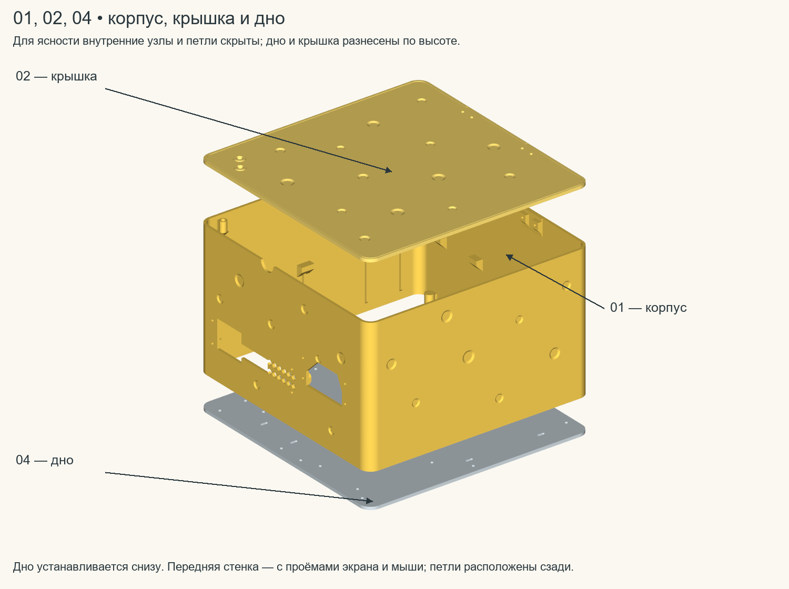

### 01 и 04: порядок окончательной установки

1. После контрольной примерки **снимите 17 с опор**, пока корпус ещё не закреплён. Держатели 19/20 можно оставить на снятом настиле; бутылку и сыр убрать. Вставлять готовый настил снизу через внутренние полки корпуса не следует: он должен опускаться **сверху на полки**, а не проходить сквозь них.
2. Поставьте 04 механизмами вверх. При отключённом питании **снимите 11 с мышью либо уберите его полностью внутрь рельсов**, при необходимости отсоединив качалку: выступающая наружу мышь может мешать опускать корпус. Совместите передний край 04 с передней стенкой 01: 09 находится напротив фигурного проёма мыши, 13 — напротив места скобы крышки. Примерьте корпус вокруг механики без усилия. Если он не опускается, проверьте ориентацию и свисающие провода; не притягивайте его винтами через помеху.
3. Совместите отверстия по периметру 04 с нижними крепёжными бобышками 01. Винты вставляются **снизу через потаи 04** в корпус. Затягивайте постепенно по кругу, не выгибая дно. Винты крепления механизмов и опор — отдельные от винтов корпуса.
4. Закрепите рамку выхода мыши **08 снаружи**, проверьте соосность с рельсами 09 и свободный ручной ход 11. Закрепите панель 05, кнопку и электронику; сохраните доступ для обслуживания.
5. Опустите настил **17 сверху через открытую верхнюю часть корпуса**, рёбрами вниз, большой выемкой вокруг 13. Посадите его на полки и опоры 18. Вставьте четыре винта сверху настила, проверьте зазоры до механики и проводки. Окончательно ставьте подарок после проверки крышки и замка.

### 21 и 22: сборка двух петель

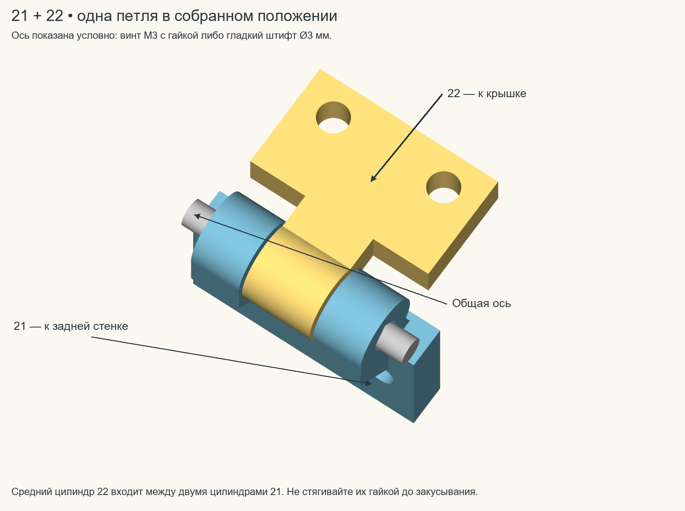

1. Отличие половинок: **21 имеет два разнесённых цилиндра**, между ними промежуток. **22 имеет один центральный цилиндр** и плоскую площадку с двумя крепёжными отверстиями.
2. Две **21** крепятся **снаружи задней стенки 01**: плоская монтажная поверхность прилегает к стенке, цилиндры находятся выше её верхней кромки и снаружи корпуса. Совместите крепёж с усиленными местами задней стенки. Винты входят снаружи в корпус.
3. Две **22** крепятся **на наружной верхней стороне крышки 02**, плоской площадкой на крышку, одиночными цилиндрами к заднему краю и половинкам 21. Внутренняя сторона крышки, где будет 16, остаётся снизу. Не крепите 22 под крышкой: оси тогда не совпадут.
4. Для каждого шарнира заведите центральный цилиндр 22 между цилиндрами 21. Совместите отверстия, вставьте ось сбоку. Ориентир — М3×25 с гайкой или гладкий штифт Ø3 мм подходящей длины. Резьба не должна насильно нарезать себе проход в подвижной половинке.
5. Сначала оставьте крепёж половинок немного свободным, совместите обе оси на одной линии и проверьте открывание. Затем затяните крепления к корпусу/крышке. Гайки на осях не должны сжимать цилиндры до закусывания; при необходимости используйте подходящие шайбы и фиксацию гайки.
6. У усиленной 21 фланец толще прежнего на 1,2 мм, у 22 — на 0,8 мм. Проверьте длины крепёжных винтов: они должны удерживать деталь, не упираться в дно отверстия и не выступать в рабочее пространство. Окончательная ведомость длин ещё не составлена.

### 02 и 16: завершение сборки крышки

1. Крышка **02** устанавливается сырными углублениями **наружу и вверх**, внутренней монтажной стороной — к подарку. Места крепления 22 находятся у заднего края, места крепления 16 — ближе к передней стенке, напротив 13–15.
2. Установите **16** по разделу замка: монтажной площадкой к внутренней стороне крышки, окном ниже крышки и напротив языка 15. Крепёж вводится сверху крышки в гайки скобы. Усиленные верхние площадки 02 добавили 1,2 мм толщины — проверьте зацепление винта в гайке.
3. С отведённым засовом медленно закройте крышку вручную. Она должна опираться на корпус, не давить на бутылку и проводку. Затем проверьте ручное зацепление скобы, а уже после этого — ограниченный ход сервы.
4. Если используется пружинка приподнимания, поставьте её в гнездо Ø4,9 мм в верхней зоне корпуса. Пружинка должна только помогать открыть крышку, а не мешать совпадению скобы и засова. При первой проверке можно обойтись без неё.
5. Первое запирание проверяйте без подарка, **с открытым доступом к крепёжным винтам 16 сверху крышки**. В случае заедания можно отсоединить скобу от крышки. На одно снятие дна не рассчитывайте: запертый засов может удерживать связанный с ним механизм. Не оставляйте испытательный привод прижатым к упору. После нескольких успешных циклов проверьте доступ к батарейкам и только затем установите бутылку, сыр и ленты.

## 11. Проверка готовой механики

- [ ] Сервы закреплены, провода не пережаты, качалки не упираются в конструкцию.
- [ ] Мышь выдвигается и убирается; ползунок не задевает рамку проёма.
- [ ] Засов удерживает скобу и полностью освобождает её при открытии.
- [ ] Крышка открывается достаточно для извлечения настоящей бутылки.
- [ ] Бутылка закреплена лентами, упаковка сыра помещается, лоток вынимается.
- [ ] Кнопка возвращается, дисплей виден через окно, LED не мешают крепежу.
- [ ] Дно можно снять для обслуживания, батарейки доступны для замены.
- [ ] При работе серв от выбранного питания ESP32 не перезагружается; два привода проверены в предусмотренных сценариях работы.

Проверки CAD подтверждают геометрию моделей, но не заменяют физическую примерку комплектующих, настройку ходов и проверку питания.

## 12. Исходники и дополнительные файлы

- Основная квадратная модель (`build_square.py`), общие детали (`../build_models.py`).
- Экспорт полного актуального набора (`build_current.py`), полная сборка STEP (`Cheese-CI-current.step`), проверка STL (`validation-current.json`).
- Вариант корпуса и панели с 12 LED (`build_12led.py`), результат проверки его STL (`12-LED/validation.json`).
- STEP корпуса и панели 12 LED (`12-LED/12-LED-front.step`) — только эти две детали, не вся сборка.
- Проверки сборки (`check_square.py`): запуск с `--current` проверяет полный актуальный вариант, без флага — базовый. Отдельные проверки посадки LED находятся в `build_12led.py`.
- Генератор поясняющих схем (`make_instruction_images.py`). Схемы условные и не предназначены для измерения или печати деталей.
- Генератор схем замка 13–16 (`make_latch_images.py`).
- Генератор схем остальных узлов (`make_assembly_images.py`).

Референс внешнего вида: [Artisan Fresh 3D Printed Cheese Keeper, DFV Tech](https://makerworld.com/en/models/2011071-artisan-fresh-3d-printed-cheese-keeper?from=search#profileId-2166438). Текущая квадратная модель построена в CadQuery с нуля; исходные STL MakerWorld не входят в этот комплект.
